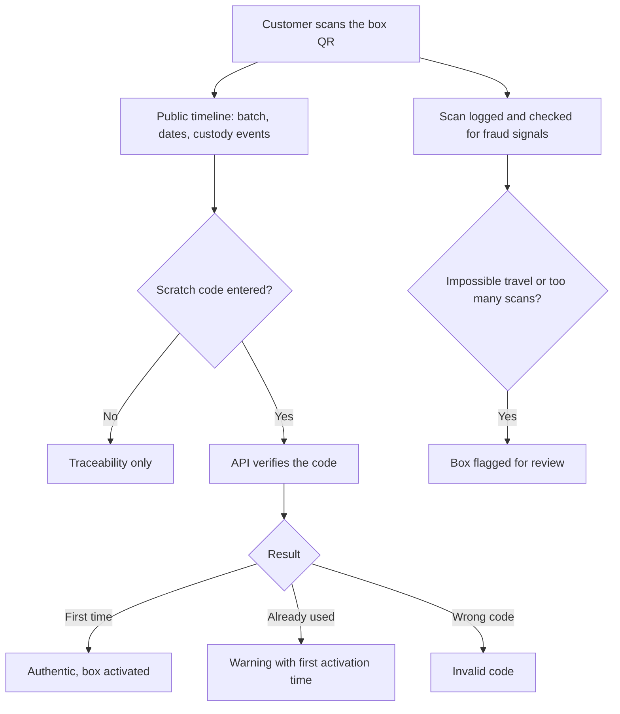

# PharmaTrace VN

A full-stack pharmaceutical supply chain and traceability platform. It covers the whole path of a medicine: manufacturer batches, warehouse and logistics operations, pharmacy retail, an online store for customers, and QR code verification to detect counterfeit products.

## Features

- **Traceability and anti-counterfeiting:** batch, carton (SSCC) and box-level tracking, public QR verification with a risk score, fraud and anomaly alerts, and batch recalls.
- **Online store (customers):** catalog and categories, cart, checkout, vouchers and flash sales, wishlist, reviews, loyalty points, prescription orders, a blog, and an English medicine assistant chatbot (Gemini RAG).
- **Admin portal:** products, categories, vouchers, orders, prescription review, returns (RMA), reviews and moderation, articles, staff and security, finance (cashbook, AR/AP), logistics and dashboards.
- **Warehouse portal:** inventory and stock counts, batch receiving, order picking, carrier handover, stock transfers and drug disposal.
- **Access control:** JWT authentication with role-based access in the API and PostgreSQL row level security (RLS) for the database role the API uses.

## Highlights

### Box-level traceability and counterfeit detection
- Every medicine box has its own UID and QR code. The public `/trace` page shows the product, batch, manufacturer, dates and a timeline of custody events: manufactured, received, transfer dispatched and received, packed, handed over, delivered and code activated.
- A scratch-off code on the box is checked by the API. The first valid entry **activates** the box, a repeat entry returns **already activated** (with the original activation time), and a wrong code returns **invalid**.
- Every scan is checked for fraud signals: **impossible travel** (consecutive scans too far apart for the time between them) and **excessive scans**. Flagged boxes appear in the admin security and fraud monitor.



### Supply chain operations
- **Procurement:** purchase orders with an approval workflow, goods receipts with attached photos, and stock updates on receipt.
- **Warehouse and logistics:** inbound batches and cartons, internal transfers between facilities, order picking and packing, carrier handover, shipments with COD reconciliation, stock counts and drug disposal.
- **Batch recall:** recall a batch and give the warehouses that hold it tasks to find and pull the affected stock.
- **Concurrency safety:** order, voucher, stock and transfer operations run in database transactions with row locks (`SELECT ... FOR UPDATE`) to prevent double spending and overselling.

### Retail and customer experience
- Prescription handling: prescription-only medicines require an uploaded prescription that a pharmacist reviews before the order proceeds.
- Vouchers (exact-code, per-scope rules), flash sales with quotas, loyalty points awarded by a daily job, returns (RMA) and unpaid orders that expire automatically.
- A blog with pharmacist-authored articles, admin approval and comments.

### Medicine assistant (Gemini RAG)
- Suggests medicines from the real catalog based on symptoms. Vectors for catalog items are kept in memory and cached on disk, so restarts do not repeat embedding calls.
- Safety first: an emergency screen (chest pain, breathing trouble, overdose and similar) runs **before** any model call, and prescription-only products are never recommended for self-purchase.
- A per-client rate limiter protects the free-tier Gemini quota, and a fallback model is used when the main model is overloaded.

### Security by design
- Role-based API access (super administrator, store manager, pharmacist, warehouse staff and more) plus PostgreSQL **row level security** policies per module, enforced because the API connects as a non-superuser role.
- No default passwords, configurable CORS, Swagger disabled in production, and secrets only through environment variables.

## Tech stack

| Layer | Technology |
|---|---|
| Backend | NestJS 11, TypeScript, Prisma 7 (`@prisma/adapter-pg`), Passport JWT, Swagger |
| Frontend | Next.js 16 (App Router), React 19, Ant Design 6, Tailwind CSS 4, Zustand, Recharts |
| Database | PostgreSQL 15 with SQL schema, functions, triggers, views and RLS policies |
| Integrations | Cloudinary (images), Google Gemini (chatbot), Google Maps (address autocomplete) |
| Infrastructure | Docker Compose, nginx reverse proxy, GitHub Actions CI |

## Repository layout

```text
.
├── pharmatrace-vn-backend/    # NestJS API (modules per domain under src/modules)
├── pharmatrace-vn-frontend/   # Next.js app: (ecom) store, admin, warehouse, trace and auth pages
├── database/                  # SQL schemas, security (RLS) scripts, seeds and SQL tests
├── deploy/nginx/              # nginx config used by the compose stack
├── docker-compose.yml         # db + backend + frontend + nginx
├── docker-compose.override.yml# local development only: publishes the database port
└── .env.example               # variables read by docker compose
```

## Quick start with Docker

Requirements: Docker with Compose.

1. Create the environment file and fill it in:

   ```powershell
   Copy-Item .env.example .env
   ```

   | Variable | Purpose |
   |---|---|
   | `DB_PASSWORD`, `DB_NAME`, `DB_PORT` | PostgreSQL superuser password, database name and the published port (development) |
   | `APP_DB_PASSWORD` | Password of the restricted `app_user` role the API connects with. Use letters and digits only, because it is placed in the connection URL |
   | `JWT_SECRET`, `JWT_EXPIRES_IN`, `QR_SECRET_KEY` | Token and QR signing |
   | `CLOUDINARY_CLOUD_NAME`, `CLOUDINARY_API_KEY`, `CLOUDINARY_API_SECRET` | Required: the API will not start without them |
   | `API_GEMINI`, `GEMINI_CHAT_MODEL`, `GEMINI_CHAT_FALLBACK_MODEL`, `GEMINI_EMBED_MODEL` | Optional: without `API_GEMINI` the chatbot is disabled |
   | `CORS_ORIGINS`, `HTTP_PORT`, `AUTH_RLS_ENABLED`, `SWAGGER_ENABLED` | Optional tuning |
   | `NEXT_PUBLIC_GOOGLE_MAPS_API_KEY` | Optional, address autocomplete (baked into the frontend at build time) |

2. Build and start everything:

   ```powershell
   docker compose up -d --build
   ```

3. Open `http://localhost` (or the port in `HTTP_PORT`). nginx serves the frontend on `/` and the API on `/v1/pharmatrace`.

On the first start with an empty database volume, the PostgreSQL container runs the scripts in `database/`: it creates `app_user`, loads the schema, applies RLS and imports the development seed data. These scripts do **not** run again on an existing volume.

To run only the database (for local development of the API and frontend): `docker compose up -d db`.

### Production

Use only the main compose file so the database port is not published:

```powershell
docker compose -f docker-compose.yml up -d --build
```

Notes:

- `DB_PASSWORD` is required and there are no default passwords. Swagger (`/api-docs`) is off when `NODE_ENV=production`; set `SWAGGER_ENABLED=true` to turn it on.
- The compose file stores the chatbot embedding cache (`/app/cache`) and uploads (`/app/uploads`) on named volumes. The embedding cache is keyed by a hash of the medicine text, the embedding model and its dimensions. If you move to a new host, copy `medicine-embeddings.json` into the `chatbot_cache` volume and keep `GEMINI_EMBED_MODEL` unchanged, otherwise every medicine is embedded again and uses Gemini quota.
- A fresh database volume still loads the demo seed data. Do not expose a database seeded this way.

## Local development without Docker for the apps

1. Start the database: `docker compose up -d db`.
2. Backend:

   ```powershell
   cd pharmatrace-vn-backend
   Copy-Item .env.example .env   # set DATABASE_URL (app_user), JWT_SECRET, Cloudinary values
   npm ci
   npx prisma generate
   npm run start:dev
   ```

   The API listens on `PORT` (3001 in the example file) under `/v1/pharmatrace`. Swagger is at `/api-docs`.

3. Frontend:

   ```powershell
   cd pharmatrace-vn-frontend
   Copy-Item .env.example .env.local   # NEXT_PUBLIC_API_URL must point to the API
   npm ci
   npm run dev
   ```

   Open `http://localhost:3000`.

### Demo accounts

The development seed contains catalog data, facilities and login accounts only (no orders or stock). Seeded accounts use these patterns:

- Customers: `customer<ID>@example.test`
- Employees: `employee<ID>@example.test` (for example `employee11` is a super administrator, `employee12` a store manager and `employee13` a pharmacist)
- Password for every seeded account: `PharmaTraceDemo2026!` (development only)

## Database

All database code lives in `database/` and is written for PostgreSQL 15.

```text
database/
├── 00_create_app_user.sh        # creates the restricted runtime role (app_user)
├── 00_master_init.sql           # orchestrates the schema, security and seed scripts
├── schemas/                     # table DDL, constraints, keys, functions and triggers
├── security/                    # grants, RLS policies and workflow safeguards, grouped by module
├── seeds/                       # development seed data (and a cleanup script)
└── tests/                       # SQL checks for RLS and workflows
```

- Docker runs the top-level entrypoints in filename order: `00_create_app_user.sh`, then `00_master_init.sql`, which loads the schemas, base permissions, seeds and each module's RLS script.
- The API connects as `app_user` (no superuser, no `BYPASSRLS`), so the policies apply to it. Use the `postgres` user only for administration and migrations.
- Changes to an existing database are applied by running the relevant SQL file by hand with `psql` as the database owner. Back up first. The bootstrap scripts do not track applied versions.
- RLS test scripts in `database/tests` can be run inside the container, for example:

  ```powershell
  docker compose exec db psql -U postgres -d phartrace-vn-db -f /docker-entrypoint-initdb.d/tests/cart_rls_test.sql
  ```

## Testing and CI

| Area | Command |
|---|---|
| Backend unit tests | `cd pharmatrace-vn-backend && npm test` |
| Backend lint and build | `npx eslint "{src,apps,libs,test}/**/*.ts"` and `npm run build` |
| Frontend utility tests | `cd pharmatrace-vn-frontend && node --test src/utils/*.test.mjs` |
| Frontend lint and build | `npm run lint` and `npm run build` |

GitHub Actions (`.github/workflows/ci.yml`) runs the same checks on every push and pull request.

## Security notes

- Never commit `.env` files. The repository ignores them.
- `PharmaTraceDemo2026!` and the seed data are for development only.
- Keep `AUTH_RLS_ENABLED` consistent with the state of your database: enable it only after the auth RLS scripts have been applied.
